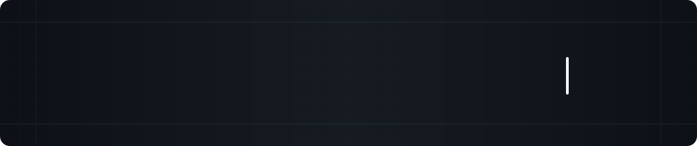

 

## WHO AM I ?

I'm a **Computer Science** student at **Ho Chi Minh City University of Technology (HCMUT)**,  
**Vietnam National University Ho Chi Minh City (VNU-HCM)**.

I'm interested in **Artificial Intelligence** and **Software Engineering**.

 

## TECHNICAL STACK

<table width="100%">
  <tr>
    <td width="20%" valign="middle"><strong>LANGUAGES</strong></td>
    <td width="80%" valign="middle">
      
      
      
    </td>
  </tr>
  <tr>
    <td width="20%" valign="middle"><strong>FRAMEWORK</strong></td>
    <td width="80%" valign="middle">
      
    </td>
  </tr>
  <tr>
    <td width="20%" valign="middle"><strong>DATABASE</strong></td>
    <td width="80%" valign="middle">
      
      
    </td>
  </tr>
  <tr>
    <td width="20%" valign="middle"><strong>BACKEND</strong></td>
    <td width="80%" valign="middle">
      
      
    </td>
  </tr>
  <tr>
    <td width="20%" valign="middle"><strong>TOOLS</strong></td>
    <td width="80%" valign="middle">
      
      
    </td>
  </tr>
  <tr>
    <td width="20%" valign="middle"><strong>AI / ML</strong></td>
    <td width="80%" valign="middle">
      
      
      
      
      
    </td>
  </tr>
</table>

 

Learning • Building • Improving

